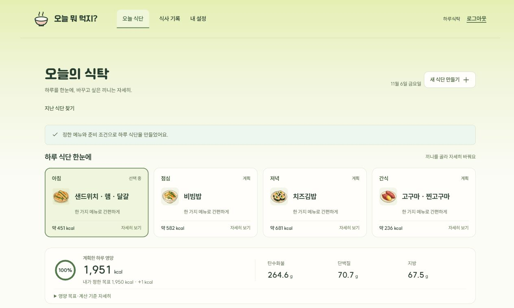
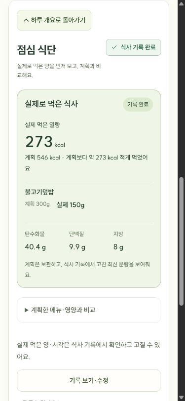

# 오늘 뭐 먹지?

취향과 목표에 맞춰 하루 식단을 추천하고, 원하는 끼니만 바꾼 뒤 실제로 먹은 양을 기록하는 웹 서비스입니다.

기존 4인 팀 프로젝트의 음식 추천 아이디어에서 출발했습니다. 이 저장소에는 후속 개인 작업으로 다시 설계하고 구현한 식단 추천·변경·기록 기능과 React 화면을 담았습니다.

## 사용 흐름

**취향과 목표 설정 → 하루 식단 추천 → 원하는 끼니의 메뉴·분량 변경 → 실제 섭취 기록**

예시 식단에서 점심 비빔밥을 불고기덮밥 300g으로 바꾸고 실제로 먹은 150g을 기록했습니다. 아래 모바일 화면에서 계획한 양과 실제로 먹은 양을 함께 확인할 수 있습니다.

## 핵심 설계

- **조건을 반영한 추천.** 저장한 선호·제외 음식과 끼니별 준비 조건을 적용해 등록된 메뉴에서 후보를 고릅니다. 열량 목표와 하루 안의 메뉴 반복을 함께 고려하고, 조건에 맞는 후보가 없으면 해당 끼니에 이유를 표시합니다. [추천·변경 설계](docs/planner.md)
- **계획을 보존하는 변경과 기록.** 선택한 끼니만 다시 추천하거나 구성 음식과 분량을 직접 바꿀 수 있습니다. 실제 섭취량은 계획과 별도로 저장합니다. 서버는 출처가 있는 기준량을 바탕으로 영양을 계산하고, 직접 입력한 음식처럼 영양을 알 수 없는 항목은 빈 값으로 남깁니다. [식사 기록 설계](docs/records.md)

## 실행과 검증

React·TypeScript로 화면을 구성하고, FastAPI에서 추천·영양 계산과 기록을 처리합니다. 계정·설정·식단·기록은 PostgreSQL에 저장하고 Alembic으로 스키마를 관리합니다.

최종 기능 반영본에서 백엔드 테스트 162개, 프론트엔드 테스트 23개, 타입 검사와 빌드가 통과했습니다. 개발 DB와 분리된 환경에서 가입부터 추천·변경·기록까지 확인했고, 화면은 데스크톱과 모바일 크기의 브라우저에서 점검했습니다. [로컬 실행 절차와 검증 범위](docs/run.md)

## 자료 출처

- 영양 자료는 공공데이터포털의 [전국통합식품영양성분정보표준데이터](https://www.data.go.kr/data/15100064/standard.do)에서 식품의약품안전처·농촌진흥청 자료를 참고했습니다. 화면의 영양 수치는 참고값입니다.
- 화면의 음식 그림은 이 프로젝트용 AI 생성 일러스트입니다.
